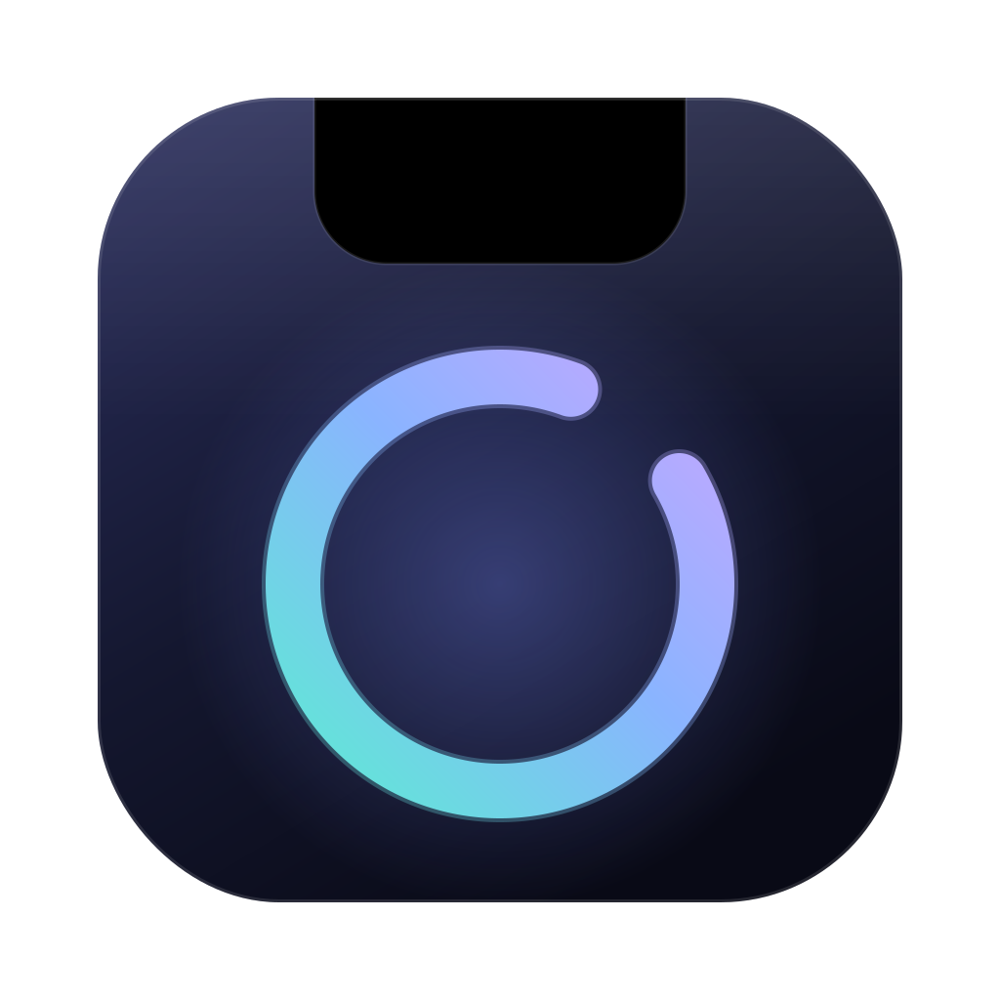

<p align="center">
  
</p>

<h1 align="center">Zenotch</h1>

<p align="center">Turns the MacBook notch into a small panel for music, events, files and timers.</p>

While collapsed, Zenotch matches the hardware notch exactly, so it looks like nothing changed.
Hover it to peek, click to open. When something is happening (music playing, a timer running,
the charger plugged in, volume or brightness changing) it shows beside the notch.

## Features

- **Now Playing**: artwork, title, seek bar and controls for Music, Spotify, Safari, Chrome and
  anything else that reports to macOS. The source app's icon opens it.
- **Calendar**: today's and tomorrow's events from the calendars on your Mac.
- **Shelf**: drag files onto the notch to park them, then drag them out wherever you need them.
- **Timer**: presets or a custom length, with the countdown shown beside the notch.
- **Clipboard history**: recent copied text, click to copy again.
- **Weather**: current conditions for your location or a city you pick.
- **Mirror**: front camera preview to check yourself before a call.
- **Battery**: level in the header, plus a charging indicator when you plug in.
- **Volume and brightness**: level shown beside the notch when they change.

Every widget can be turned off in Settings. Disabled widgets stop their background work.

## Requirements

- A Mac with macOS 14 Sonoma or later, Apple silicon or Intel
- Works best on a MacBook with a notch. On other displays, turn on
  "Show a notch on displays without one" in Settings.

## Install

1. Download `Zenotch-x.y.z.zip` from [Releases](https://github.com/fillahfirdausyah/zenotch/releases/latest) and unzip it.
2. Move `Zenotch.app` to `/Applications`.
3. Open it. Zenotch is not notarized by Apple, so the first launch is blocked. Either
   right-click the app, choose **Open** and confirm, or run:

   ```sh
   xattr -dr com.apple.quarantine /Applications/Zenotch.app
   ```

Zenotch lives in the menu bar; there is no Dock icon. Use the menu bar icon for Settings and Quit,
and turn on "Open Zenotch at login" in Settings to start it automatically.

## Privacy and permissions

Zenotch has no accounts, analytics or telemetry. The only network request is the weather lookup.

| Feature   | Permission                     | Notes                                                           |
|-----------|--------------------------------|-----------------------------------------------------------------|
| Calendar  | Calendars                      | Read only, asked when you open the tab.                         |
| Weather   | Location                       | Not needed if you pick a city. Coordinates go to Open-Meteo.    |
| Mirror    | Camera                         | The camera runs only while the Mirror tab is open.              |
| Clipboard | None                           | Kept in memory, cleared on quit. Password manager items skipped.|

## Build from source

Needs the Xcode Command Line Tools (`xcode-select --install`). Xcode itself is not required.

```sh
git clone https://github.com/fillahfirdausyah/zenotch.git
cd zenotch
scripts/run.sh          # debug build, bundle to build/Zenotch.app and launch
scripts/bundle.sh       # release build to build/Zenotch.app
scripts/test.sh         # unit tests
scripts/release.sh 0.1.0  # universal (Apple silicon + Intel) zip and checksum in build/
```

The build is ad-hoc signed, so macOS asks for permissions again after each rebuild. Set
`SIGN_IDENTITY` to a code signing certificate in your keychain to keep them.

### Project layout

| Path | Contents |
|------|----------|
| `Sources/Zenotch` | App entry point |
| `Sources/ZenotchKit` | Notch window, widgets and settings |
| `Bridge/` | Objective-C helper that reads Now Playing info (see below) |
| `Resources/` | `Info.plist`, app icon set and menu bar image |
| `design/` | Icon sources, not shipped in the app |
| `scripts/` | Build, run, test and debug scripts |

### How some parts work

- **Now Playing.** Since macOS 15.4, the private MediaRemote framework only answers Apple-signed
  processes. Zenotch loads `Bridge/MediaRemoteBridge.m` into `/usr/bin/perl`, which is
  Apple-signed, and reads JSON lines from it. This is the approach used by
  [mediaremote-adapter](https://github.com/ungive/mediaremote-adapter). A future macOS release
  may break it.
- **Volume and brightness.** Read from CoreAudio and DisplayServices change callbacks, so no
  Accessibility permission is needed. The system HUD still appears as well.
- **App icon.** `actool` needs Xcode, so `scripts/bundle.sh` builds `AppIcon.icns` from
  `Resources/AppIcon.appiconset` with `iconutil`.
- **`@ViewState`.** The macOS 27 SDK turns SwiftUI's `@State` into a macro whose plugin ships only
  with Xcode. Views use a `ViewState` alias for the same property wrapper instead.

### Debugging

Debug builds accept commands from `scripts/drive.sh`: `expand`, `collapse`, `tab <widget>`,
`media <play|pause|toggle|next|previous>`, `timer <seconds>`, `snapshot <path.png>`,
`statusicon <path.png>`.

```sh
log stream --predicate 'subsystem == "com.fillx.zenotch"' --level debug
```

## Known limitations

- Not notarized, so Gatekeeper blocks the first launch (see [Install](#install)).
- The system volume and brightness HUD still appears next to Zenotch's.
- Now Playing depends on a workaround that Apple could close in a future macOS update.

## License

Copyright (C) 2026 Fillah Akbar Firdausyah.

Zenotch is free software under the [GNU General Public License v3.0](LICENSE).

Weather data by [Open-Meteo.com](https://open-meteo.com/) (CC BY 4.0).
